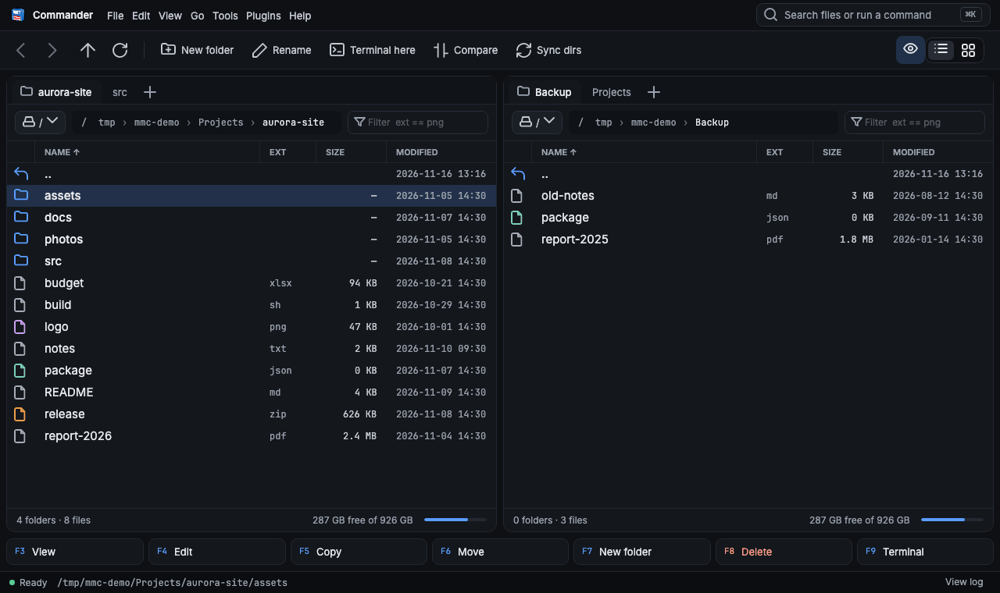
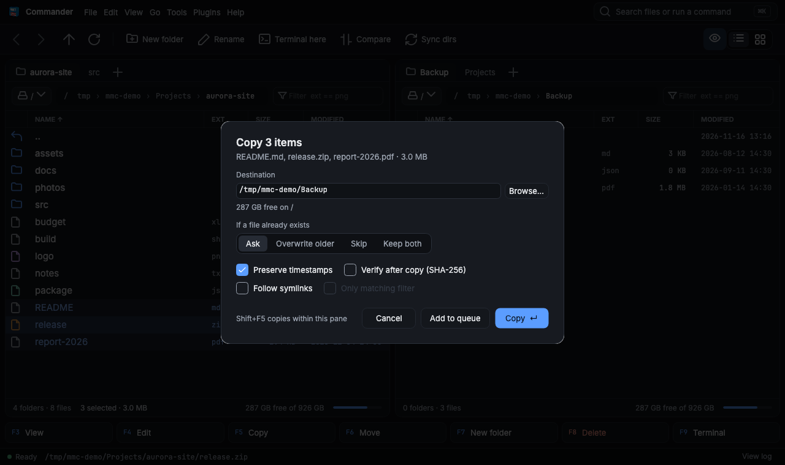

# MMCommander

**A keyboard-driven two-panel file manager for Windows, macOS and Linux.**
It uses .NET 10, Avalonia 12 and CommunityToolkit.Mvvm. The license is [MIT](LICENSE).

**Documentation: <https://mmpyro.github.io/MMCommander/>**



## Highlights

- Two panels with tabs. Each tab has its own back and forward history, and the open tabs come back on the next start. See [Panels](#panels-and-tabs).
- Copy and move run as jobs, with a progress window, pause and cancel, a queue, conflict policies and a SHA-256 check. See [Copy](#copy-and-move).
- A command palette. Press Ctrl+K (⌘K) and type a command, a file name or a path. See [Palette](#command-palette).
- A filter language, for example `ext -> (png, pdf) & name like report`. See [Filter](#filter).
- A thumbnail view for image folders. See [Thumbnails](#thumbnails).
- Compare and synchronize directories. See [Compare](#compare-directories).
- Compare two files side by side, edit both sides and save. See [Compare files](#compare-files).
- Archives. Create zip (optionally AES-256), tar.gz and tar.bz2. Extract 7z, rar and more. See [Archives](#archives).
- Themes and keys. Choose Dark or Black (OLED) and one of five accent colours, and change any key. See [Settings](#settings-and-themes).
- Plugins that are plain .NET class libraries. See [Plugins](#plugins).

## Install

Download the archive for your system from [Releases](https://github.com/mmpyro/MMCommander/releases):

| System | File |
|---|---|
| Windows (x64) | `MMCommander-<version>-win-x64.zip` |
| Linux (x64) | `MMCommander-<version>-linux-x64.tar.gz` |
| macOS (Apple silicon) | `MMCommander-<version>-osx-arm64.tar.gz` |

1. Check the download: `sha256sum -c SHA256SUMS.txt --ignore-missing`. On macOS, use `shasum -a 256` instead of `sha256sum`.
2. Unpack the archive and run `Commander` (`Commander.exe` on Windows). Keep all the files in one folder, because the app reads `Config.xml`, `Commands.xml` and `Manuals/` from it.
3. On macOS the build is not notarized. Before the first start, run `xattr -dr com.apple.quarantine <folder>` once.

Each build is self-contained, so you do not need to install .NET. To build the app yourself, see [Development](#development).

## Tour

### Panels and tabs


Each panel has these parts:
- Folder tabs. Ctrl+T opens a tab, and Ctrl+W closes it.
- A breadcrumb. Click a segment to go to that folder. To type a path, click the empty part.
- A filter box.
- A footer. It shows the folder and file counts, the marked size and the free space.

Space or Insert marks the file under the cursor, and the footer adds up the marked files. The panel with the blue border is the active panel. The toolbar, the menus and the F-key bar act on it. Tab switches between the panels.

To sort a panel, click a column header (Name, Ext, Size or Modified). Click it again to reverse the order. The keys are Ctrl+F3 to Ctrl+F6, and View → Sort by has the same commands. The ".." entry stays at the top, and folders stay above files. Each panel keeps its sort until you close the app.

### Copy and move



F5 (copy) and F6 (move) open a dialog with these options:
- The destination.
- What to do when a file exists: ask, overwrite older, skip, or keep both.
- Keep the timestamps or not.
- Verify each copy with SHA-256.
- Follow symlinks or not.

You can also drag files with the mouse to the other panel: a drop opens the copy dialog, and Shift+drop opens the move dialog. Drags to and from Finder or Explorer work too.

Then the copy runs as a job in a progress window. In that window you can pause the job, cancel it or send it to the background. **Add to queue** starts the job after the current job ends. If you mark nothing, the app uses the file under the cursor.

F8 moves the files to the Trash: the Windows Recycle Bin, macOS `~/.Trash` or the Linux freedesktop Trash. Shift+F8 deletes them permanently.

### Command palette


Press **Ctrl+K** (⌘K on macOS). Type part of a command name, a file name in the active panel, or a full folder path, and press Enter. Each command shows its key, so the palette also helps you learn the keys.

### Filter


Type an expression into the filter box above the list. [Filter language](#filter-language) gives the syntax.

### Thumbnails


Use the view switch on the toolbar (the list and grid icons) to show the active panel as thumbnails. An image shows as a preview, and other files show as a large icon. The keys, the marks and the cursor work as they do in the list.

### Compare directories


**Shift+F2** compares the two panels by name, size and date, or by content. It can include subfolders. The window shows which files are on one side only, which are newer, and which are the same. **Synchronize…** copies the differences in the direction of the arrows.

### Compare files

**Shift+F3** compares two files line by line. If you marked two files in the active panel, it compares those two. If not, it compares the file under the cursor in the left panel with the file under the cursor in the right panel. The window puts changed lines side by side and highlights the characters that are different.

You can also edit the files in this window. The app writes nothing to disk until you press **Save**.

| Key | Action |
|---|---|
| F7 / Shift+F7 | Next / previous difference |
| Tab | Switch between the left and right side |
| Alt+Right / Alt+Left | Copy the difference under the cursor to the right / left |
| Enter or F2, or double-click | Edit the line. While you edit, Enter splits the line, Backspace at the start joins it to the line above, and Up/Down go to the next line |
| Ctrl+Y | Delete the line |
| Ctrl+Z | Undo |
| Ctrl+S | Save the changed files. If a file changed on disk after you opened it, the app asks first |
| F5 | Read both files again |

The window keeps the line endings and the encoding. If you save a file without a change, the bytes stay the same.

If one of the files is not text, or is larger than 20 MB, the window shows a hex comparison that you cannot edit. It counts the bytes that are different and lists the first 4 MB.

### Settings and themes

| Settings → Appearance | Black (OLED) theme, teal accent |
|---|---|
|  |  |

To open Settings, use View → Settings… or press Ctrl+, (⌘, on macOS). You can set these items:
- The theme (Dark, or Black for OLED screens) and the accent colour.
- The row density and the fonts.
- The date and size formats.
- Hidden files, folder sizes on Space, coloured icons, and a separate Ext column.
- The default conflict policy.
- All the keyboard shortcuts: record, presets, conflicts and export.

You see each change at once. **Done** saves the changes, and **Cancel** undoes them.

## Keyboard

[docs/shortcuts.md](docs/shortcuts.md) lists all the default keys. A test generates that page from the command registry of the app. These keys are the most used: Enter opens a folder, Tab switches the panel, and Space marks a file. F5 copies, F6 moves, F8 moves to the Trash, and Ctrl+K opens the command palette.

On macOS each Ctrl shortcut also works with ⌘, except Ctrl+H and Ctrl+Tab. Help → Keyboard shortcuts opens the list in Settings, where you can change any key. You can also add a key in the user `Config.xml`:

```xml
<KeyBindings>
  <Binding command="copy" keys="F5;Ctrl+Shift+C" />
</KeyBindings>
```

The status bar shows the latest message. Errors are red, and warnings are orange. To see the full text, hover over the message. To see all the messages of this session, click **View log**. The log file has the full stack traces (Help → Open log folder).

## Filter language

Type in the filter box above the list. The list updates 1 s after the last key press.

| Expression | Meaning |
|---|---|
| `ext == pdf` / `ext != pdf` | Extension is / is not `pdf` |
| `ext -> (pdf, txt)` / `ext <> (pdf, txt)` | Extension is in / not in the set |
| `name == report` | Name without extension equals |
| `name like rep` | Name contains |
| `type is dir` / `type is file` | Only folders / only files |
| `a & b`, `a \| b` | And / or, applied left to right |

- Example: `ext -> (xml, pdf) & name like il`.
- Write the keywords in lowercase. The filter ignores case when it compares values.

## Folder shortcuts

Type a shortcut into the path box: `%temp%`, `%desktop%`, `%documents%`, `%programdata%`, `%pf%`, `%pf86%` or `%windows%`. Ctrl+D adds your own.

## Archives

| Format | Create | Extract |
|---|---|---|
| zip (optionally AES-256) | yes | yes |
| tar, tar.gz, tar.bz2 | yes, without a password | yes |
| 7z, rar, gz | no | yes |

The app does not extract an entry that would land outside the target folder (zip-slip).

## Configuration

| File | Location | Purpose |
|---|---|---|
| `Config.xml` (defaults) | next to the binary | Editor and terminal per OS |
| `Config.xml` (user) | macOS `~/Library/Application Support/MMCommander/`, Windows `%APPDATA%\MMCommander\`, Linux `~/.config/MMCommander/` | Panel paths, tabs, settings and shortcuts. The app writes it on exit, in one atomic step |
| `Commands.xml` | next to the binary | External commands for the Commands menu |
| logs | NLog, see `LogLib/NLog.config` | 10 MB per file, 7 archives |

### Editor and terminal

To choose the editor (F4) and the terminal (F9), go to Settings → Tools. Type a command line such as `code {path}`, or choose a preset. The app puts the selected file (F4) or the panel folder (F9) in place of `{path}`. If a program path has spaces, put it in quotes: `"C:\Program Files\Notepad++\notepad++.exe" {path}`.

The app saves these values in the user `Config.xml`, so an update keeps them. If you reset the box (leave it empty), the app uses the default:

| OS | Editor (F4) | Terminal (F9) |
|---|---|---|
| Windows | `notepad.exe` | `cmd.exe` |
| macOS | the default text editor (`open -t`) | Terminal |
| Linux | `$VISUAL`, then `$EDITOR`, then `xdg-open`. A terminal editor (`vim`, `nano`, …) opens in `x-terminal-emulator` | `x-terminal-emulator` |

If the program cannot start, the log shows "Cannot start '…'".

The defaults come from the `Config.xml` that ships with the app. Each token in `args` that a space separates is one argument. `{path}` stays one argument, also when the path has spaces:

```xml
<Program name="notepad" os="osx" args="-t {path}">open</Program>
```

In `Commands.xml`, `{s}` is the file selected in the left panel, and `{d}` is the file selected in the right panel. This example uses an external diff tool instead of the built-in one ([Shift+F3](#compare-files)):

```xml
<Command name="Compare Files"><Parameter>kdiff3 -args {s} {d}</Parameter></Command>
```

### Updates

Once a day, when it starts, the app asks GitHub for the latest release. If that release is newer, a dialog shows its release notes:

- **Update and restart** downloads the archive for your platform and checks it against `SHA256SUMS.txt`. Then it replaces the app files and starts the new version. If the checksum does not match, the app stops before it changes a file.
- **Later** asks again on another day. **Skip this version** stops the questions about that version.
- Help → Check for updates asks GitHub at once. It ignores Skip. If there is nothing new, the log shows "You are up to date".
- Settings → Tools → "Check for updates at startup" turns off the startup check. Then the app makes no network call.

The app installs the update itself only from an unpacked release folder that it can write to. In other cases, for example a folder under Program Files or `dotnet run`, the button opens the release page. The app keeps each replaced file as `<name>.old` until the next start. Files that you added to the folder, such as plugins, stay. If the new version does not start, delete the new files and rename the `.old` files back. The user `Config.xml` is not in the app folder, so an update keeps your settings.

## Plugins

Put a .NET 10 class library in `Plugins/<Name>/` next to the binary. Then press Ctrl+P to run it on the selected files. A plugin runs with the full rights of your user account, so install only plugins that you trust.
- [docs/PLUGINS.md](docs/PLUGINS.md) tells you how to write a plugin.
- The working sample, `SamplePlugins/Sha256Sums`, writes a `SHA256SUMS` file for the selected files.

## Development

You need the .NET SDK 10. `global.json` pins 10.0.403 and rolls forward to newer feature bands.

```sh
dotnet run --project Commander          # start the app
dotnet test MMCommander.sln             # run all tests (about 210)
sh docs/make-screenshots.sh            # regenerate the images and clips in docs/images (needs ffmpeg)
```

To publish a self-contained single-file build:

```sh
dotnet publish Commander -c Release -r osx-arm64 --self-contained -p:PublishSingleFile=true
dotnet publish Commander -c Release -r win-x64   --self-contained -p:PublishSingleFile=true
dotnet publish Commander -c Release -r linux-x64 --self-contained -p:PublishSingleFile=true
```

Keep `Config.xml`, `Commands.xml`, `Manuals/` and `Plugins/` next to the binary. The app reads them from `AppContext.BaseDirectory`, so it works from any working directory.

[docs/ARCHITECTURE.md](docs/ARCHITECTURE.md) has the design notes.

### CI and releases

- A pull request to `master` runs `.github/workflows/ci.yml` on Linux, Windows and macOS. The build fails on any warning except CS0067, and on any NuGet package with a known vulnerability. All the tests must pass.
- A pushed tag such as `v2.0.0` runs `.github/workflows/release.yml`. This workflow runs the same tests and builds the `win-x64`, `linux-x64` and `osx-arm64` archives. Then it creates a GitHub Release with generated notes, the archives and `SHA256SUMS.txt`. The version comes from the tag.
- To try the release build without a release, use Actions → Release → Run workflow. The archives show up as workflow artifacts.

```sh
git tag v2.0.0 && git push origin v2.0.0
```

### Documentation site

MkDocs Material builds the site at <https://mmpyro.github.io/MMCommander/> from `mkdocs.yml` and `docs/`. `.github/workflows/docs.yml` builds the site for each pull request and deploys it from `master`.

```sh
pip install -r docs/requirements.txt
mkdocs serve                            # preview at http://127.0.0.1:8000
MMC_UPDATE_DOCS=1 dotnet test CommanderTest --filter ShortcutsDocTest   # regenerate docs/shortcuts.md after a key change
```

`CommanderTest/DocsScreenshots.cs` makes the images and clips. It renders the real app headless, with a demo folder and a throwaway config.

## Known limits

- The app can extract 7z archives but cannot create them.
- CI runs the tests on Linux, Windows and macOS, but only the macOS build got a manual test.
- The file clipboard (Ctrl+C / Ctrl+V) needs file support in the OS clipboard. Nobody tested it on Linux yet.
- Split runs in the background but has no progress bar.
- The macOS build is not signed or notarized.
- Only the tests cover the self-update. Nobody tried yet to replace a running `Commander.exe` on Windows by hand.

## License

[MIT](LICENSE) © 2015-2026 Michał Marszałek
