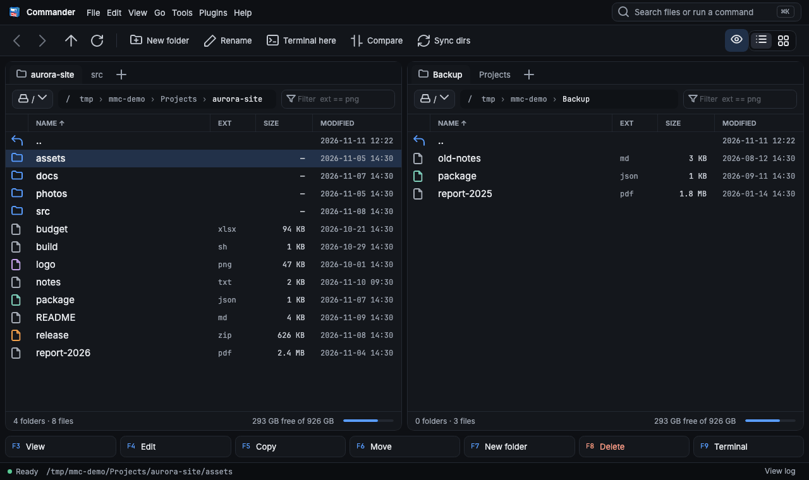
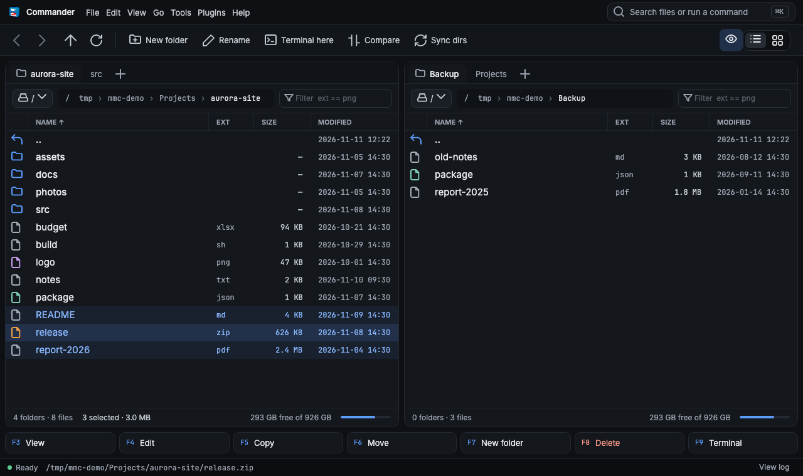
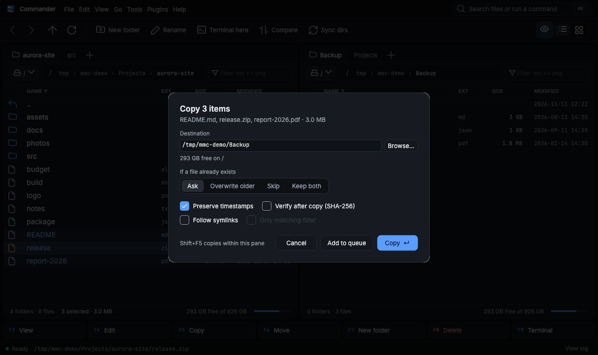
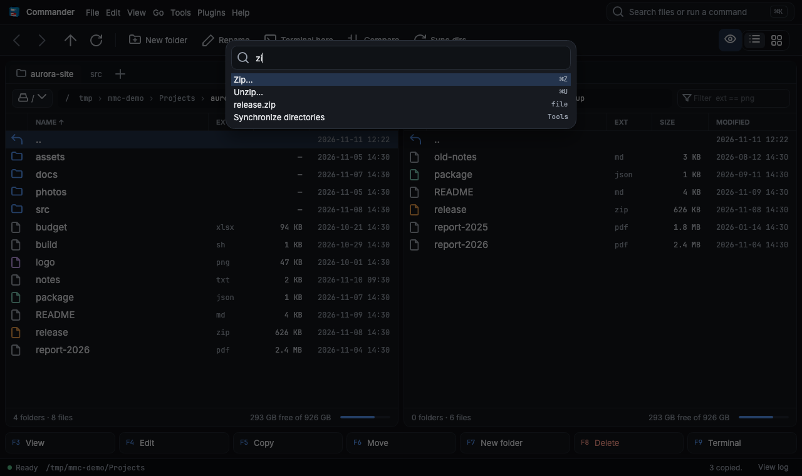
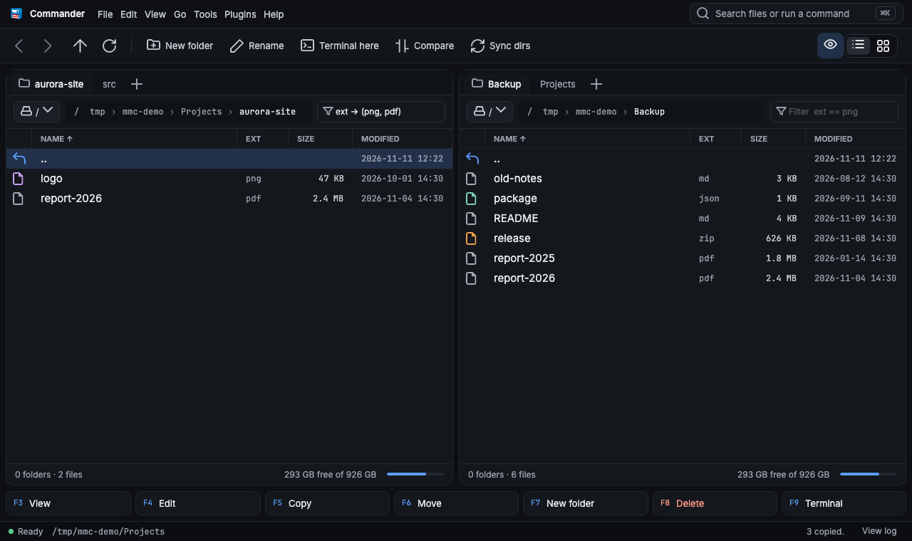
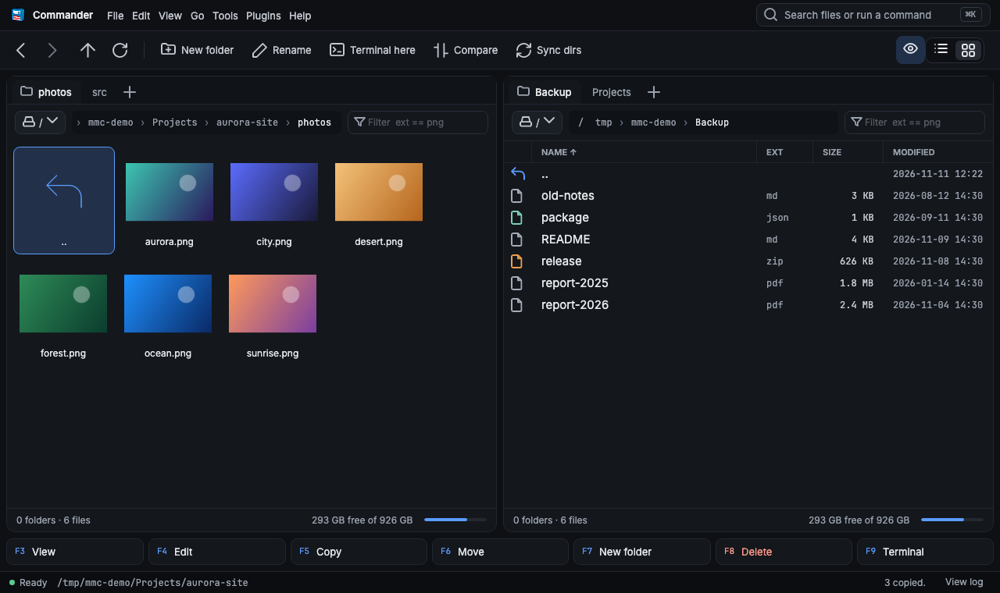
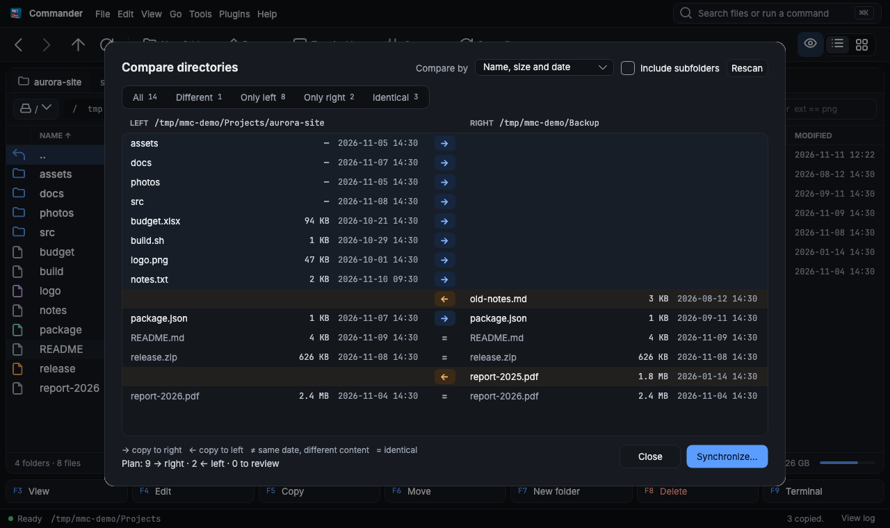
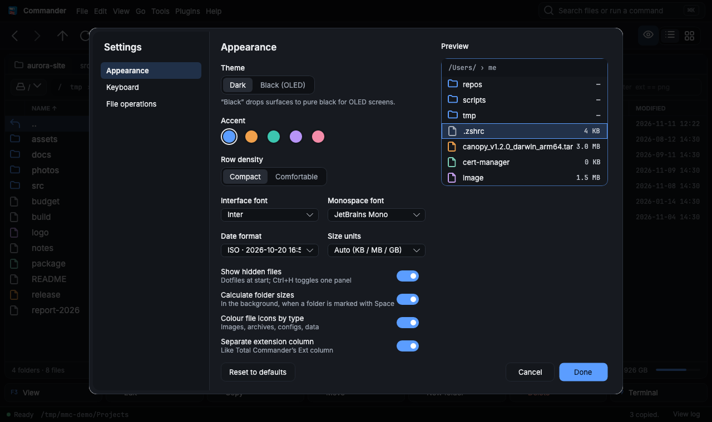
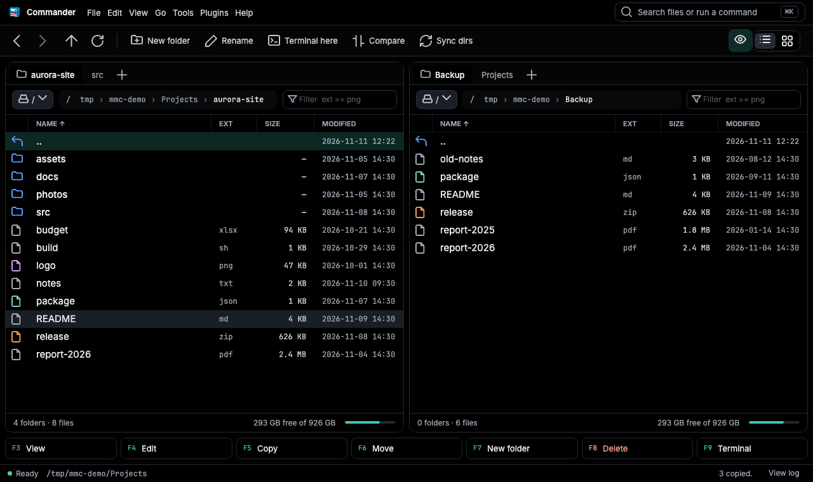

# MMCommander

**A keyboard-driven two-panel file manager for Windows, macOS and Linux.**
Built on .NET 10, Avalonia 12 and CommunityToolkit.Mvvm. Released under the [MIT license](LICENSE).



## Highlights

- **Two panels with tabs.** Every tab has its own back/forward history, and the open tabs come back on the next start. [→ Panels](#panels-and-tabs)
- **Copy and move as jobs.** You get a progress window, pause and cancel, a queue, conflict policies and SHA-256 verify. [→ Copy](#copy-and-move)
- **Command palette.** Press Ctrl+K (⌘K) and type a command, a file name or a path. [→ Palette](#command-palette)
- **Filter language.** For example `ext -> (png, pdf) & name like report`. [→ Filter](#filter)
- **Thumbnail view** for image folders. [→ Thumbnails](#thumbnails)
- **Compare and synchronize directories.** [→ Compare](#compare-directories)
- **Archives.** Create zip (optionally AES-256), tar.gz and tar.bz2; extract 7z, rar and more. [→ Archives](#archives)
- **Themes and shortcuts.** Choose Dark or Black (OLED), five accent colours, and rebind any key. [→ Settings](#settings-and-themes)
- **Plugins** written as plain .NET class libraries. [→ Plugins](#plugins)

## Install

Download the archive for your system from [Releases](https://github.com/mmpyro/MMCommander/releases):

| System | File |
|---|---|
| Windows (x64) | `MMCommander-<version>-win-x64.zip` |
| Linux (x64) | `MMCommander-<version>-linux-x64.tar.gz` |
| macOS (Apple silicon) | `MMCommander-<version>-osx-arm64.tar.gz` |

1. Check the download: `sha256sum -c SHA256SUMS.txt --ignore-missing` (on macOS use `shasum -a 256` instead of `sha256sum`).
2. Unpack the archive and run `Comander` (`Comander.exe` on Windows). Keep the folder together: the app reads `Config.xml`, `Commands.xml` and `Manuals/` from it.
3. On macOS the build is not notarized, so run `xattr -dr com.apple.quarantine <folder>` once before the first start.

Each build is self-contained, so you don't need to install .NET. To build it yourself, see [Development](#development).

## Tour

### Panels and tabs



Each panel has:
- folder tabs (Ctrl+T opens one, Ctrl+W closes it);
- a clickable breadcrumb. Click a segment to jump there, or click the empty part to type a path;
- a filter box;
- a footer with the folder and file counts, the marked size and the free space.

Space or Insert marks the file under the cursor, and the footer adds up what is marked. The panel with the blue border is the active one. The toolbar, the menus and the F-key bar act on it, and Tab switches between panels.

### Copy and move



F5 (copy) and F6 (move) open an options dialog with these choices:
- the destination;
- what to do when a file exists: ask, overwrite older, skip, or keep both;
- whether to keep timestamps;
- SHA-256 verify;
- whether to follow symlinks.

The copy then runs as a job with a progress window, where you can pause, cancel or send it to the background. **Add to queue** runs it after the current job. With nothing marked, the file under the cursor is used.

F8 moves the files to the Trash: the Windows Recycle Bin, macOS `~/.Trash` or the Linux freedesktop Trash. Shift+F8 deletes them permanently.

### Command palette



Press **Ctrl+K** (⌘K on macOS) and type part of a command name, a file name in the active panel, or a full folder path, then press Enter. Each command shows its shortcut, so the palette also helps you learn the keys.

### Filter



Type an expression into the filter box above the list. See [Filter language](#filter-language) for the syntax.

### Thumbnails



The view switch on the toolbar (the list and grid icons) shows the active panel as thumbnails. Images get a preview and other files a large icon. Keys, marking and the cursor work the same as in the list.

### Compare directories



**Shift+F2** compares the two panels by name, size and date, or by content. It can include subfolders. The window shows what exists only on one side, what is newer, and what is identical. **Synchronize…** copies the differences in the direction of the arrows.

### Settings and themes

| Settings → Appearance | Black (OLED) theme, teal accent |
|---|---|
|  |  |

Open it with View → Settings…, or Ctrl+, (⌘, on macOS). You can set:
- the theme (Dark or Black for OLED) and the accent colour;
- row density and fonts;
- date and size formats;
- hidden files, folder sizes on Space, coloured icons, and a separate Ext column;
- the default conflict policy;
- every keyboard shortcut: record, presets, conflicts and export.

Changes show at once. **Done** saves them, and **Cancel** undoes them.

## Keyboard

The keys work in the focused file panel.

| Key | Action | Key | Action |
|---|---|---|---|
| Enter | Open folder | Tab | Switch panel |
| Backspace / Esc | Parent folder | Home | Drive root |
| F3 / E | Open with default app | F4 / N | Open in editor |
| F5 / C | Copy to other panel | F6 / M | Move to other panel |
| F7 / F1 | New folder | Shift+F4 | New file |
| F8 / Delete | Move to Trash (asks first) | Shift+F6 / F2 | Rename |
| Shift+F8 | Delete permanently | Shift+F5 | Copy within this panel |
| F9 / Shift+C | Terminal here | Ctrl+R | Refresh |
| Space / Insert / S | Mark / unmark file | Ctrl+A / A | Mark all |
| R | Invert marks | T | Mark all of this type |
| Ctrl+Z | Zip selection | Ctrl+U | Extract archive |
| Ctrl+C | Copy files to clipboard | Ctrl+V | Paste files from clipboard |
| Ctrl+I | File info | Ctrl+D | Add folder bookmark |
| Ctrl+P | Plugins | Ctrl+Shift+T | Folder tree |
| Ctrl+E | Run as admin (Windows) | Ctrl+H | Hide / show dot files and folders |
| Ctrl+T | New tab | Ctrl+W | Close tab |
| Alt+Left | Back | Alt+Right | Forward |
| Ctrl+Tab | Next tab | Ctrl+L | Type a path |
| Ctrl+K | Command palette | Shift+F2 | Compare directories |

On macOS every Ctrl shortcut also works with ⌘, except Ctrl+H and Ctrl+Tab. Help → Keyboard shortcuts opens the list in Settings, where you can change any key. You can also add a key in the user `Config.xml`:

```xml
<KeyBindings>
  <Binding command="copy" keys="F5;Ctrl+Shift+C" />
</KeyBindings>
```

The status bar shows the latest message: errors in red, warnings in orange. Hover it for the full text, or click **View log** to see every message from this session. Full stack traces go to the log file (Help → Open log folder).

## Filter language

Type in the filter box above the list. The list updates 1 s after the last key press.

| Expression | Meaning |
|---|---|
| `ext == pdf` / `ext != pdf` | Extension is / is not `pdf` |
| `ext -> (pdf, txt)` / `ext <> (pdf, txt)` | Extension is in / not in the set |
| `name == report` | Name without extension equals |
| `name like rep` | Name contains |
| `type is dir` / `type is file` | Only folders / only files |
| `a & b`, `a \| b` | And / or, applied left to right |

- Example: `ext -> (xml, pdf) & name like il`.
- Keywords are lowercase. Values are matched case-insensitively.

## Folder shortcuts

Type a shortcut into the path box: `%temp%`, `%desktop%`, `%documents%`, `%programdata%`, `%pf%`, `%pf86%` or `%windows%`. Ctrl+D adds your own.

## Archives

| Format | Create | Extract |
|---|---|---|
| zip (optionally AES-256) | yes | yes |
| tar, tar.gz, tar.bz2 | yes, without a password | yes |
| 7z, rar, gz | no | yes |

Extraction refuses entries that would land outside the target folder (zip-slip).

## Configuration

| File | Location | Purpose |
|---|---|---|
| `Config.xml` (defaults) | next to the binary | Editor and terminal per OS |
| `Config.xml` (user) | macOS `~/Library/Application Support/MMCommander/`, Windows `%APPDATA%\MMCommander\`, Linux `~/.config/MMCommander/` | Panel paths, tabs, settings and shortcuts. Written on exit, atomically |
| `Commands.xml` | next to the binary | External commands for the Commands menu |
| logs | NLog, see `LogLib/NLog.config` | 10 MB per file, 7 archives |

In `Config.xml`, each space-separated token in `args` is one argument, and `{path}` becomes the selected file, so paths with spaces stay intact:

```xml
<Program name="notepad" os="osx" args="-t {path}">open</Program>
```

In `Commands.xml`, `{s}` is the file selected in the left panel and `{d}` the file selected in the right one:

```xml
<Command name="Compare Files"><Parameter>kdiff3 -args {s} {d}</Parameter></Command>
```

## Plugins

Put a .NET 10 class library in `Plugins/<Name>/` next to the binary, then press Ctrl+P to run it on the selected files. Plugins run with your full user rights, so install only ones you trust.
- How to write one: [docs/PLUGINS.md](docs/PLUGINS.md).
- A working sample, `SamplePlugins/Sha256Sums`, writes a `SHA256SUMS` file for the selected files.

## Development

You need the .NET SDK 10. `global.json` pins 10.0.403 and rolls forward to newer feature bands.

```sh
dotnet run --project Comander          # start the app
dotnet test MMComander.sln             # run all tests (about 210)
sh docs/make-screenshots.sh            # regenerate the images in docs/images (needs ffmpeg)
```

Publish a self-contained single-file build:

```sh
dotnet publish Comander -c Release -r osx-arm64 --self-contained -p:PublishSingleFile=true
dotnet publish Comander -c Release -r win-x64   --self-contained -p:PublishSingleFile=true
dotnet publish Comander -c Release -r linux-x64 --self-contained -p:PublishSingleFile=true
```

Keep `Config.xml`, `Commands.xml`, `Manuals/` and `Plugins/` next to the binary. The app reads them from `AppContext.BaseDirectory`, so it works from any working directory.

Design notes: [docs/ARCHITECTURE.md](docs/ARCHITECTURE.md).

### CI and releases

- **Pull requests to `master`** run `.github/workflows/ci.yml` on Linux, Windows and macOS. The build fails on any warning except CS0067 and on any vulnerable NuGet package, and every test must pass.
- **Pushing a tag such as `v2.0.0`** runs `.github/workflows/release.yml`. It runs the same tests, builds the `win-x64`, `linux-x64` and `osx-arm64` archives, then creates a GitHub Release with generated notes, the archives and `SHA256SUMS.txt`. The version comes from the tag.
- **To try the release build without releasing**, use Actions → Release → Run workflow. The archives appear as workflow artifacts.

```sh
git tag v2.0.0 && git push origin v2.0.0
```

The images in this README come from `ComanderTest/DocsScreenshots.cs`. It renders the real app headless, with a demo folder and a throwaway config.

## Known limits

- 7z archives can be extracted but not created.
- CI runs the tests on Linux, Windows and macOS, but only the macOS build has been tried by hand.
- The file clipboard (Ctrl+C / Ctrl+V) depends on the OS clipboard's file support, and it is untested on Linux.
- Split runs in the background but has no progress bar.
- The macOS build is not signed or notarized.

## License

[MIT](LICENSE) © 2015-2026 Michał Marszałek
