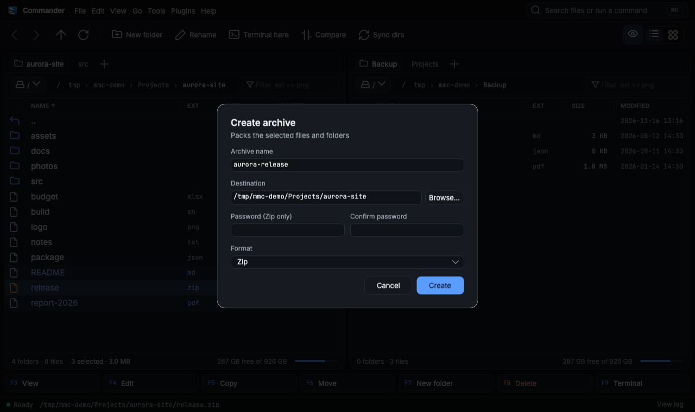

# Archives

**Ctrl+Z** packs the marked files and folders into an archive. Choose the format, the name and the destination.
For zip, you can also set a password (AES-256). **Ctrl+U** extracts the archive under the cursor.

| Format | Create | Extract |
|---|---|---|
| zip (optionally AES-256) | yes | yes |
| tar, tar.gz, tar.bz2 | yes, without a password | yes |
| 7z, rar, gz | no | yes |

The app does not extract an entry that would land outside the target folder (zip-slip).

## Split and join

**Tools → Split file…** cuts a large file into parts of a chosen size, and **Join files…** puts them back together.
