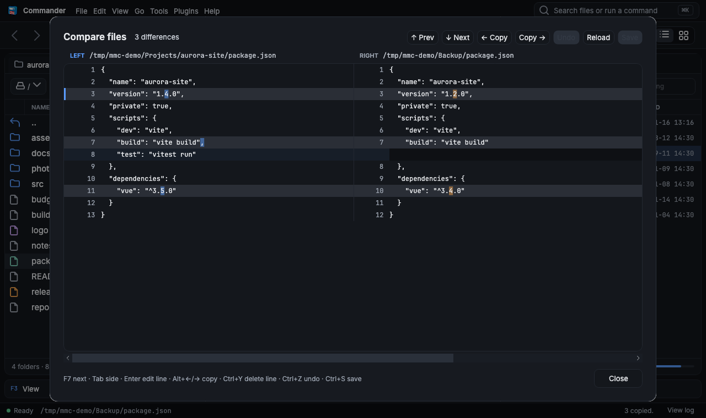

# Compare

## Compare directories

<video autoplay loop muted playsinline poster="../images/compare.png" aria-label="Shift+F2 compares the two panels">
  <source src="../images/compare.mp4" type="video/mp4">
</video>

**Shift+F2** compares the two panels by name, size and date, or by content. It can include subfolders. The window
shows which files are on one side only, which are newer, and which are the same. **Synchronize…** copies the
differences in the direction of the arrows.

## Compare files

**Shift+F3** compares two files line by line. If you marked two files in the active panel, it compares those two.
If not, it compares the file under the cursor in the left panel with the file under the cursor in the right panel.
The window puts changed lines side by side and highlights the characters that are different.

You can also edit the files in this window. The app writes nothing to disk until you press **Save**.

| Key | Action |
|---|---|
| F7 / Shift+F7 | Next / previous difference |
| Tab | Switch between the left and right side |
| Alt+Right / Alt+Left | Copy the difference under the cursor to the right / left |
| Enter or F2, or double-click | Edit the line. While editing, Enter splits the line, Backspace at the start joins it with the line above, and Up/Down move to the next line |
| Ctrl+Y | Delete the line |
| Ctrl+Z | Undo |
| Ctrl+S | Save the changed files. If a file changed on disk in the meantime, it asks first |
| F5 | Read both files again |

The window keeps the line endings and the encoding. If you save a file without a change, the bytes stay the same.

If one of the files is not text, or is larger than 20 MB, the window shows a hex comparison that you cannot edit.
It counts the bytes that are different and lists the first 4 MB.

To use an external diff tool instead, add it to `Commands.xml`. See [Settings](settings.md#editor-and-terminal).
