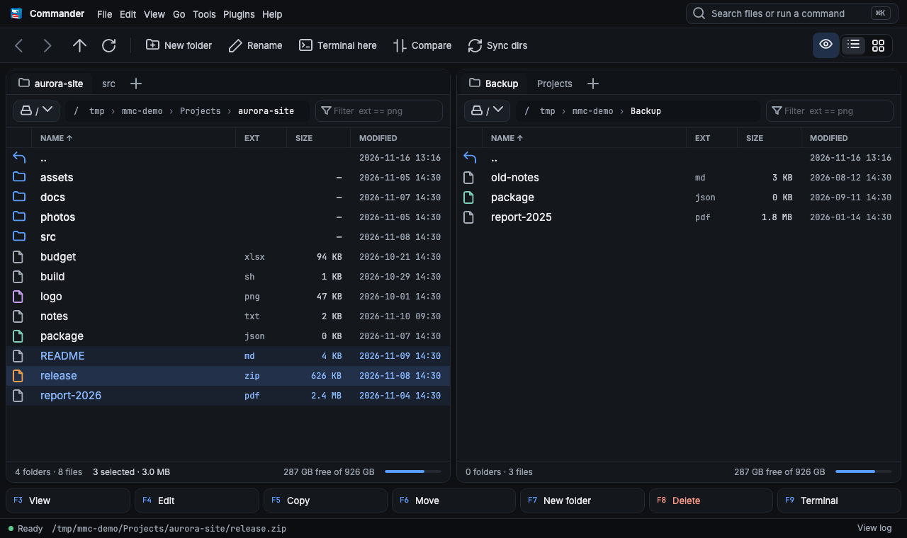

# Panels and tabs

Each panel has these parts:

- Folder tabs. **Ctrl+T** opens a tab, **Ctrl+W** closes it, and **Ctrl+Tab** goes to the next one. Each tab has
  its own back and forward history (**Alt+Left** / **Alt+Right**). The open tabs come back on the next start.
- A breadcrumb. Click a segment to go to that folder. To type a path, click the empty part or press **Ctrl+L**.
- A [filter](filter.md) box.
- A footer. It shows the folder and file counts, the marked size and the free space.

**Space** or **Insert** marks the file under the cursor, and the footer adds up the marked files. **Ctrl+A** marks
all files, **R** inverts the marks, and **T** marks all files of the same type.

The panel with the blue border is the active panel. The toolbar, the menus and the F-key bar act on it. **Tab**
switches between the panels.

## Folder shortcuts

Type a shortcut into the path box: `%temp%`, `%desktop%`, `%documents%`, `%programdata%`, `%pf%`, `%pf86%` or
`%windows%`. **Ctrl+D** adds the current folder to your bookmarks. The Navigation menu has the bookmarks, the
history and a folder tree (**Ctrl+Shift+T**).

## Hidden files

**Ctrl+H** hides or shows the dot files and folders in the active panel. You set the default for both panels in
[Settings](settings.md).
