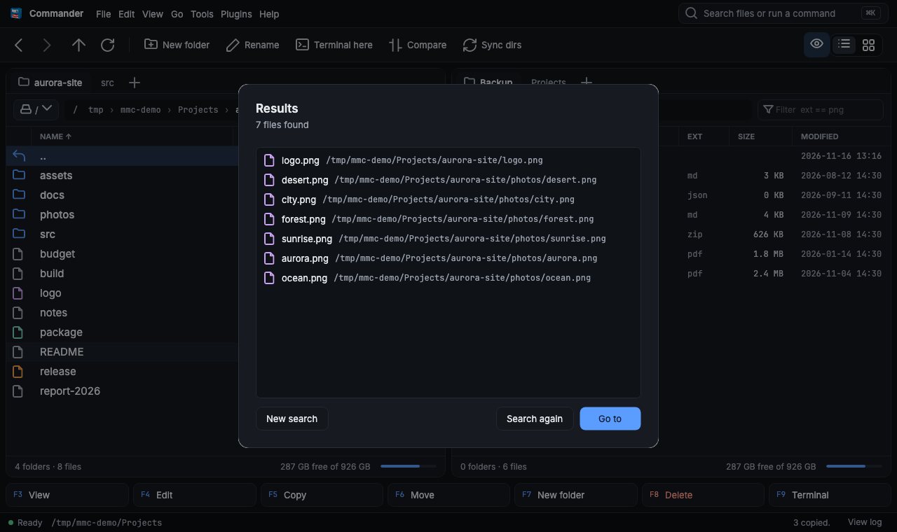

# Search

Open **Tools → Search files…** or type "search" in the [command palette](palette.md). It starts in the active
panel's folder.

| Field | Meaning |
|---|---|
| Look in | The folder to search. **Browse…** picks another one |
| Name | A file name or a regular expression, for example `.*\.pdf` |
| Whole name / Contains | Match the whole file name, or any part of it |
| Ignore case | Match regardless of upper and lower case |
| Include subfolders | Search the whole tree below the folder |

Press **Enter** or **Search**. Each result shows as soon as the search finds it. **Stop** ends the search early.
To open the folder of a result, select the result and press **Go to**. The panel opens that folder and puts the
cursor on the file. **Search again** runs the same search again, and **New search** goes back to the fields.

The search skips folders that you cannot read, and it skips links (reparse points). Thus a search never stops
halfway.
