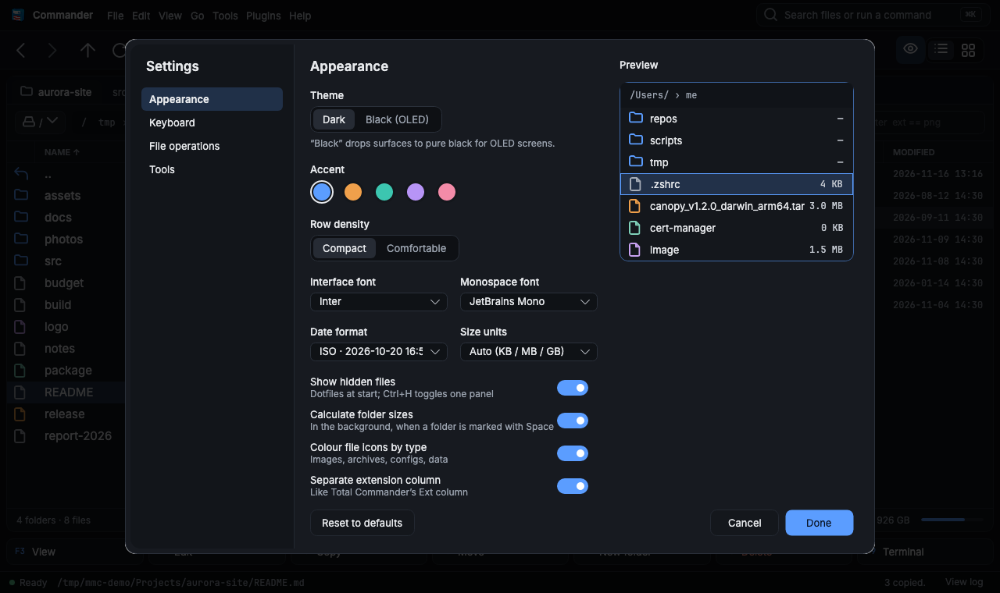
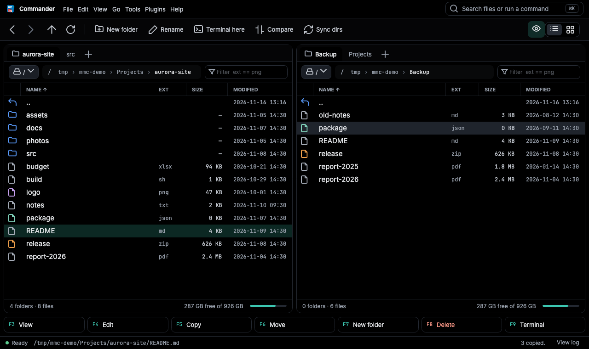

# Settings and themes

| Settings → Appearance | Black (OLED) theme, teal accent |
|---|---|
|  |  |

To open Settings, use **View → Settings…** or press **Ctrl+,** (⌘, on macOS). You can set these items:

- The theme (Dark, or Black for OLED screens) and the accent colour.
- The row density and the fonts.
- The date and size formats.
- Hidden files, folder sizes on Space, coloured icons, and a separate Ext column.
- The default conflict policy.
- The editor (F4) and the terminal (F9).
- The update check at startup, on or off.
- All the keyboard shortcuts.

You see each change at once. **Done** saves the changes, and **Cancel** undoes them.

## Keyboard

Help → Keyboard shortcuts opens Settings on the Keyboard page. On this page you can record a new key for a
command, load a preset, see conflicts and export the map. [Keyboard shortcuts](../shortcuts.md) lists the default
keys.

On macOS every Ctrl shortcut also works with ⌘, except Ctrl+H and Ctrl+Tab. You can also add a key in the user
`Config.xml`:

```xml
<KeyBindings>
  <Binding command="copy" keys="F5;Ctrl+Shift+C" />
</KeyBindings>
```

## Editor and terminal

To choose the editor (F4) and the terminal (F9), go to Settings → Tools. Type a command line such as
`code {path}`, or choose a preset. The app puts the selected file (F4) or the panel folder (F9) in place of `{path}`.
If a program path has spaces, put it in quotes: `"C:\Program Files\Notepad++\notepad++.exe" {path}`. If you leave
the box empty, the app uses the default:

| OS | Editor (F4) | Terminal (F9) |
|---|---|---|
| Windows | `notepad.exe` | `cmd.exe` |
| macOS | the default text editor (`open -t`) | Terminal |
| Linux | `$VISUAL`, then `$EDITOR`, then `xdg-open`. A terminal editor (`vim`, `nano`, …) opens in `x-terminal-emulator` | `x-terminal-emulator` |

If the program cannot start, the log shows "Cannot start '…'".

`Commands.xml` is next to the binary. In this file you add your own commands to the Commands menu. `{s}` is the
file selected in the left panel, and `{d}` is the file selected in the right panel. This example adds an external
diff tool:

```xml
<Command name="Compare Files"><Parameter>kdiff3 -args {s} {d}</Parameter></Command>
```

## Updates

Once a day, when it starts, the app asks GitHub for the latest release. If that release is newer, a dialog shows
its release notes:

- **Update and restart** downloads the archive for your platform and checks it against `SHA256SUMS.txt`. Then it
  replaces the app files and starts the new version. If the checksum does not match, the app stops before it
  changes a file.
- **Later** asks again on another day. **Skip this version** stops the questions about that version.
- Help → Check for updates asks GitHub at once. It ignores Skip. If there is nothing new, the log shows "You are up
  to date".
- Settings → Tools → "Check for updates at startup" turns off the startup check. Then the app makes no network
  call.

The app installs the update itself only from an unpacked release folder that it can write to. In other cases, for
example a folder under Program Files or `dotnet run`, the button opens the release page. The app keeps each replaced
file as `<name>.old` until the next start. Files that you added to the folder, such as plugins, stay. If the new
version does not start, delete the new files and rename the `.old` files back.
