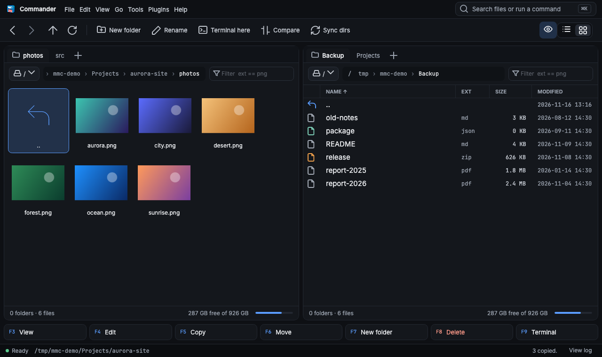

# Thumbnails

Use the view switch on the toolbar (the list and grid icons) to show the active panel as thumbnails. An image shows
as a preview, and other files show as a large icon. The keys, the marks and the cursor work as they do in the list.
