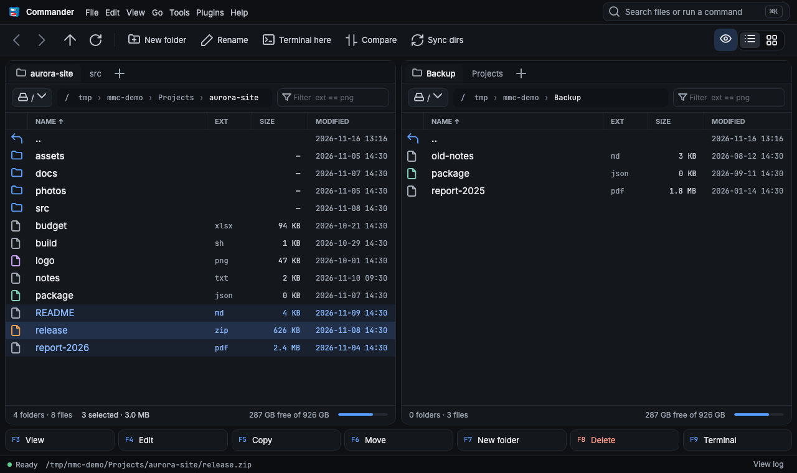

# Getting started

## The two panels

The window shows two folders side by side. The panel with the blue border is the active one: the toolbar, the menus
and the F-key bar act on it. **Tab** switches between the panels.

- **Enter** opens a folder, **Backspace** goes up, **Home** goes to the drive root.
- **Ctrl+L** lets you type a path. Click a breadcrumb segment to jump there.
- **Ctrl+T** opens a tab, **Ctrl+W** closes it. Open tabs come back on the next start.

## Mark and copy

1. Move the cursor with the arrow keys and press **Space** to mark a file. The footer adds up the marked size.
2. Press **F5** to copy the marked files to the other panel, or **F6** to move them.
3. Pick what happens when a file exists, then press **Enter**. The copy runs as a job with a progress window.

If you mark nothing, the app uses the file under the cursor.

## Find any command

Press **Ctrl+K** (⌘K on macOS) and type part of a command name, a file name or a folder path. Each command shows its
key, so the palette is also the quickest way to learn the keys. The full list is on
[Keyboard shortcuts](shortcuts.md).

## Where your settings live

| File | Location |
|---|---|
| Defaults (`Config.xml`, `Commands.xml`) | next to the binary |
| Your `Config.xml` (panel paths, tabs, settings, keys) | macOS `~/Library/Application Support/MMCommander/`, Windows `%APPDATA%\MMCommander\`, Linux `~/.config/MMCommander/` |

The app writes your `Config.xml` when it closes, in one atomic step. An update never replaces this file.

The status bar shows the latest message: errors in red, warnings in orange. Click **View log** to see every message
from this session. Full stack traces go to the log file (Help → Open log folder).
