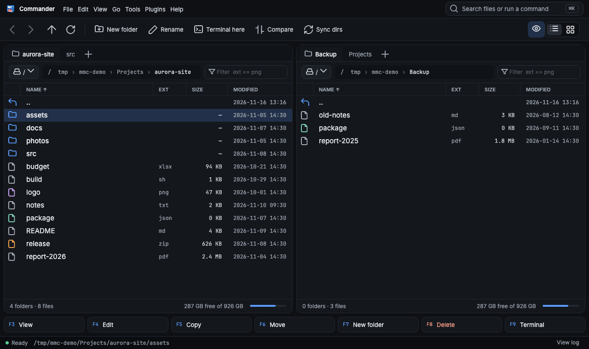

---
hide:
  - navigation
  - toc
---

# MMCommander

A keyboard-driven two-panel file manager for Windows, macOS and Linux.

[Download](https://github.com/mmpyro/MMCommander/releases/latest){ .md-button .md-button--primary }
[Get started](getting-started.md){ .md-button }

MMCommander shows two folders side by side, and you work on them from the keyboard. Space marks a file, F5 copies,
F6 moves, and Ctrl+K finds any command. The app uses .NET 10 and Avalonia 12. Each platform gets one self-contained
folder, and the license is MIT.

## What it does

-   :material-view-split-vertical: **[Panels and tabs](features/panels.md)**

    Two panels, folder tabs with their own history, a breadcrumb you can click, and a footer with the marked size.

-   :material-content-copy: **[Copy, move and delete](features/copy.md)**

    Jobs with progress, pause and cancel, a queue, conflict policies, a SHA-256 check and the system Trash.

-   :material-magnify: **[Search](features/search.md)**

    Find files by name or regular expression, in one folder or with its subfolders. Then go to a result.

-   :material-filter-variant: **[Filter language](features/filter.md)**

    `ext -> (png, pdf) & name like report` narrows the list as you type.

-   :material-compare-horizontal: **[Compare](features/compare.md)**

    Compare and synchronize two folders, or compare two files side by side and edit both.

-   :material-zip-box-outline: **[Archives](features/archives.md)**

    Create zip (optionally AES-256), tar.gz and tar.bz2; extract 7z, rar and more.

-   :material-image-multiple-outline: **[Thumbnails](features/thumbnails.md)**

    Show an image folder as a grid of previews, with the same keys as the list.

-   :material-console-line: **[Command palette](features/palette.md)**

    Ctrl+K (⌘K) runs a command, opens a file or goes to a path. Each command shows its key.

-   :material-palette-outline: **[Settings and themes](features/settings.md)**

    Dark or Black (OLED), five accent colours, fonts, row density, your own editor and terminal. You can change every key.

-   :material-puzzle-outline: **[Plugins](PLUGINS.md)**

    Plain .NET class libraries that run on the selected files.

## Download

| System | File |
|---|---|
| Windows (x64) | `MMCommander-<version>-win-x64.zip` |
| Linux (x64) | `MMCommander-<version>-linux-x64.tar.gz` |
| macOS (Apple silicon) | `MMCommander-<version>-osx-arm64.tar.gz` |

All the files are on the [latest release](https://github.com/mmpyro/MMCommander/releases/latest) page.
[Install](install.md) tells you how to check the download and start the app on each system.
